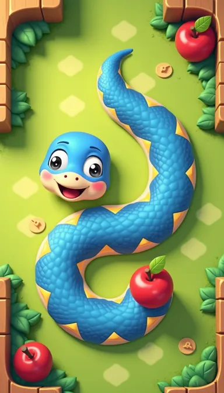

# Classic Snake: art direction

Concept rendered with FLUX on spark (`art/gen/prompts/snake_concept_blue.json`). The game draws the snake procedurally to match it; only fruit and the meadow are painted sprites.

## Snake

- One continuous tube along a smoothed spline through the body cells, corners rounded, no visible segments.
- Royal blue body `#2f7fe0`, light blue top highlight, a cream belly edge on one side, a thick navy outline `#163a7a`, soft drop shadow down and right.
- Sunny yellow diamonds along the back, outlined in orange, shrinking with the body.
- Tapers over the last two cells to a rounded point.
- The head is a wider rounded blob of the same tube: cream snout, pink blush, two big white eyes with navy rims and black pupils that look at the fruit, a blink every few seconds.
- A red forked tongue flicks when idle; the mouth opens wide as the fruit gets close and gulps on eating.
- Squash and stretch: the head stretches on a turn and squashes on a gulp. A swallowed fruit rides down the body as a bulge.
- Dead: greyed blue, X eyes, tongue out, dizzy stars circling the head.

## Board

- Opaque two-tone lawn checker so the snake reads on a small phone, a chunky rounded wooden frame with a top highlight, a soft inner shadow.
- Fruit bobs with a shadow that breathes, a white shine, and pops in. Eating bursts sparkles and a ring, with a crunch and a pop that rises in pitch through the stage.

## Pre-readers

- The ready screen shows an animated finger swiping and speaks "Swipe to steer the snake to the fruit!".
